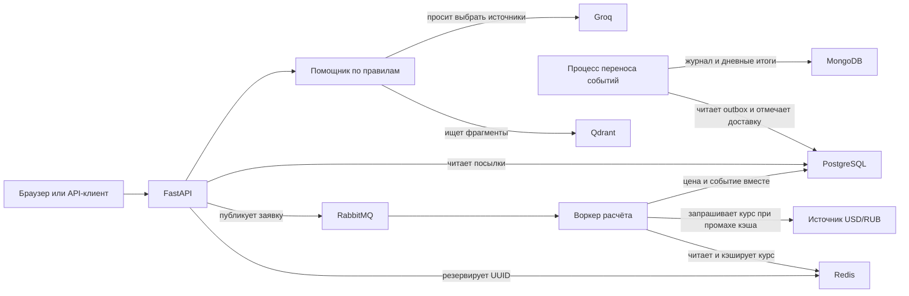

# Delivery Service — разбор проекта и сценарий демонстрации


> Delivery Service — учебный сервис расчёта стоимости международной доставки. Отправитель вводит вес и стоимость содержимого в долларах, получает номер заявки, а затем видит цену доставки в рублях. Основная инженерная задача — сохранить правильный результат, даже если источник курса временно недоступен или очередь дважды отдаст одну заявку. Покажу это на одной посылке, а затем прослежу, как её стоимость попадает в дневной отчёт.

В проекте три роли. **Отправитель** создаёт посылку, видит свою историю и запрашивает ключ для перевозчика. **Перевозчик** с этим ключом закрепляет посылку за своей компанией через API. **Оператор** получает сводку расчётов и может повторно поставить сохранённую посылку в очередь. Географический маршрут, адреса, оплата и отслеживание физического перемещения лежат за пределами проекта. Слово «статус» в интерфейсе относится к расчёту цены.

## 1. Одна посылка от формы до отчёта

Возьмём ноутбук весом **2 кг** с объявленной стоимостью **100 USD**. Здесь две разные денежные величины. Стоимость содержимого задаёт отправитель в долларах, а цену услуги вычисляет сервис в рублях.

| Момент | Что делает система | Что может увидеть отправитель |
| --- | --- | --- |
| Открытие главной страницы | Сервер выдаёт браузеру подписанную cookie с идентификатором владельца. Страница загружает справочник типов. | Форму регистрации, свою историю и помощника по правилам. |
| Нажатие «Зарегистрировать посылку» | Браузер отправляет данные, CSRF-токен и ключ операции. API проверяет поля и тип, резервирует UUID заявки в Redis и публикует сообщение в RabbitMQ. | После подтверждения от RabbitMQ приходит HTTP `202 Accepted` с UUID и адресом проверки статуса. |
| Начало обработки | Фоновый процесс, **воркер**, читает сообщение и сохраняет в PostgreSQL строку со статусом `pending`. | Посылка появляется в истории. До расчёта интерфейс показывает «Не рассчитано». |
| Расчёт | Воркер берёт курс USD/RUB, вычисляет цену и одной транзакцией сохраняет результат и событие для отчёта. | Статус «Рассчитано» и сумма в рублях. Главная страница сама опрашивает статус раз в три секунды и обновляет список. |
| Учёт в отчёте | Отдельный процесс читает событие, записывает его в журнал MongoDB и увеличивает итог за день. | В карточке уже есть цена. Оператор может увидеть её вклад в отчёте за московскую дату расчёта. |

**Что именно считается.** Каждый килограмм добавляет к тарифу 0,50 USD, а содержимое — ещё 1% своей объявленной стоимости. Полученную сумму сервис переводит в рубли по курсу. Для ноутбука при **условном** курсе 90 RUB/USD:

```text
Весовая часть                 2 × 0,50 = 1,00 USD
Часть от стоимости          100 × 0,01 = 1,00 USD
Доставка в рублях      (1,00 + 1,00) × 90 = 180,00 ₽
```

На живом стенде итог для этого ноутбука составит **2 USD по курсу, который получил воркер**, с округлением до копеек. Тип «электроника» нужен для хранения, фильтрации и отчёта. Коэффициенты формулы одинаковы для всех трёх типов. Расчёт использует `Decimal`, чтобы представлять десятичные суммы точно, и один раз округляет конечный результат по правилу `ROUND_HALF_UP`. Например, 12,345 рубля превращаются в 12,35. [Формула и определение отчётного дня](src/delivery_service/domain.py)

## 2. Из каких частей состоит приложение

Python 3.12 обслуживает и сайт, и фоновые процессы. Docker Compose запускает один и тот же код в разных ролях. Стрелки показывают, кто к кому обращается.



| Компонент | Почему он здесь | Пример данных |
| --- | --- | --- |
| FastAPI, Pydantic | Обслуживают HTTP и проверяют контракт на входе. Один прикладной слой используется сайтом и API-клиентами. | Название длиной 1–255 символов, положительный вес с точностью до трёх знаков, неотрицательная стоимость с точностью до двух. |
| Jinja2, JavaScript, HTMX | Сервер формирует HTML. JavaScript отправляет форму и опрашивает статус, HTMX подгружает фрагмент таблицы при изменении фильтра или статуса. | Главная страница, карточка, фильтры, светлая и тёмная темы. |
| RabbitMQ | Хранит задания до обработки и позволяет запускать несколько воркеров независимо от API. | Основная очередь `parcels.register`, очереди отложенных повторов, очередь ошибок `parcels.failed`. |
| Redis | Несколько процессов совместно используют краткоживущие данные. | Резервация ключа запроса на 24 часа, ранний статус, кэш курса, ограничитель частоты вопросов. |
| PostgreSQL, SQLAlchemy, Alembic | PostgreSQL хранит посылки и обеспечивает атомарность изменений. SQLAlchemy выражает запросы на Python, Alembic создаёт схему и справочник типов. | Владелец, вес, объявленная стоимость, курс, цена, перевозчик и событие для отчёта. |
| MongoDB | Оператор может читать журнал и готовые итоги, пока основной сервис продолжает регистрировать посылки. | Одно событие на расчёт, количество и сумма в копейках по типу и дню. |
| FastEmbed, Qdrant, LangChain, Groq | Обслуживают вопросы о правилах. FastEmbed переводит текст в числовой вектор, Qdrant находит близкие тексты, LangChain передаёт кандидатов модели Groq для выбора. | Фрагмент учебных правил об упаковке ноутбука и его идентификатор источника. |

Цена такого разделения — несколько сервисов для запуска и задержка между расчётом и появлением суммы в отчёте. Преимущество видно при сбое MongoDB: воркер продолжает сохранять цены в PostgreSQL, а отчёт может догнать их после восстановления связи. [Конфигурация процессов и зависимостей](compose.yaml)

## 3. Как читать состояния и понимать повторы

| Статус API | Где хранится | Что уже произошло |
| --- | --- | --- |
| `publishing` | Redis | UUID зарезервирован, подтверждение публикации ещё не отражено в статусе. |
| `queued` | Redis | RabbitMQ подтвердил приём. Строка в основной таблице может появиться чуть позже. |
| `pending` | PostgreSQL | Посылка сохранена. Воркер рассчитывает цену либо ждёт повторной попытки. |
| `calculated` | PostgreSQL | Цена и событие для отчёта зафиксированы. |
| `failed` | PostgreSQL | Для сохранённой посылки обработчик исчерпал запланированные попытки. Оператор может запустить повтор. |

Статус регистрации сначала ищется в PostgreSQL и только при отсутствии строки — в Redis. Поэтому после `202` проверять нужно адрес `status_url` из ответа. Список посылок читает PostgreSQL и на этом раннем этапе может быть пуст. Если воркер работает быстро, на экране можно сразу увидеть «Рассчитано».

**Если пропал ответ на регистрацию.** Браузер мог отправить заявку, а связь могла оборваться до получения `202`. Повтор с тем же заголовком `Idempotency-Key` и теми же данными в пределах 24 часов вернёт тот же UUID в этой сессии. Redis атомарно закрепляет ключ за исходными данными. Попытка использовать ключ с другим содержимым даст `409 Conflict`. Та же заявка может повторно попасть в RabbitMQ. За единственный расчёт отвечает следующий уровень защиты.

**Если два воркера получили одну посылку.** Первичный ключ UUID позволяет вставить строку только один раз. Перед фиксацией цены воркер блокирует её в PostgreSQL и снова проверяет статус. Если другой воркер уже записал `calculated`, обработка заканчивается. Это также покрывает падение воркера после сохранения результата, но до подтверждения обработки сообщения брокеру. Подтверждение обработки называется **ACK**.

**Если недоступен источник курса.** Воркер использует действующую запись в Redis, по умолчанию срок её жизни — час. Если запись истекла, один процесс запрашивает котировку у `cbr-xml-daily.ru` и делит `USD.Value` на `USD.Nominal`. Короткая блокировка ограничивает число одновременных обновлений. При неудаче сервис откладывает расчёт. Задержки перед повторами составляют 10 секунд, 1 минуту, 5 минут, 30 минут и 2 часа. Перед ACK исходного сообщения воркер дожидается подтверждения публикации повтора. После исчерпания попыток сообщение уходит в **DLQ** — отдельную очередь для разбора ошибок. Сообщение с некорректным форматом попадает туда сразу. [Регистрация и проверка статуса](src/delivery_service/services.py) · [Воркер](src/delivery_service/worker.py) · [Очереди](src/delivery_service/broker.py) · [Курс](src/delivery_service/rates.py)

## 4. Что хранится в базе и как устроен отчёт

В PostgreSQL три основные таблицы. `parcel_types` содержит справочник: 1 — одежда, 2 — электроника, 3 — разное. В `parcels` одна строка соответствует одной посылке. В `calculation_outbox` одна строка означает, что конкретный расчёт нужно передать в отчётность. У этого события свой `event_id`, а ограничение уникальности по `parcel_id` допускает одно событие на посылку. [Модели таблиц](src/delivery_service/db.py) · [Начальная миграция](migrations/versions/0001_initial.py)

**Зачем нужен outbox.** Представьте, что воркер записал цену, затем процесс аварийно завершился перед отправкой данных в MongoDB. Отправитель увидел бы сумму, которую отчёт никогда не учтёт. Здесь цена и поручение передать событие сохраняются в **одной транзакции PostgreSQL**: либо обе записи фиксируются вместе, либо обе откатываются. Это и есть паттерн *transactional outbox*.

Отдельный процесс берёт до 50 ожидающих событий. В транзакции MongoDB он вставляет запись в журнал `calculations` и увеличивает счётчик и сумму в `daily`. Затем отмечает доставку в PostgreSQL. Если процесс остановится между двумя базами, он прочитает событие снова. Уникальный идентификатор записи в MongoDB позволит распознать уже учтённое событие. Так повторная доставка сохраняет правильную сумму. Для транзакций MongoDB локальный Compose поднимает **replica set** из одного узла.

День определяется по моменту **расчёта** в часовом поясе `Europe/Moscow`. Посылка, зарегистрированная до полуночи и рассчитанная после, попадёт в следующий день. Итог отвечает на вопрос «сколько посылок каждого типа рассчитано и на какую общую стоимость доставки?». Для ноутбука из примера электроника получит **+1** к количеству и **+18 000 копеек** к сумме при условном курсе 90.

Для каждого дня и типа сумма распределена по 64 корзинам по хешу события. Это снижает конкуренцию за одну запись при параллельных обновлениях. Дневной отчёт суммирует до 192 записей при трёх типах. Поле `pending_outbox` показывает количество неперенесённых событий **по всему сервису**. Пока оно больше нуля, `provisional` принимает значение `true`. Команда `verify-report` независимо пересчитывает суммы из журнала и сверяет их с агрегатами за выбранный день. [Запись событий и агрегация](src/delivery_service/reporting.py) · [Команды оператора](src/delivery_service/cli.py)

## 5. Пользователь, доступ и назначение перевозчика

Учётных записей с паролями здесь нет. Сервис узнаёт отправителя по подписанной cookie `delivery_session`, по умолчанию сроком на 30 дней. Подпись позволяет обнаружить изменение идентификатора. Сервер ограничивает чтение текущим владельцем. Чужой UUID и отсутствующая посылка дают одинаковый ответ `404`. При утрате cookie восстановление доступа к старой истории через интерфейс не предусмотрено.

Три разных ключа удобно объяснить через вопросы, на которые они отвечают:

| Механизм | На какой вопрос отвечает | Где используется |
| --- | --- | --- |
| `X-CSRF-Token` | Отправлен ли запрос с токеном, соответствующим текущей сессии? | При изменяющих состояние POST-запросах владельца. Защищает от отправки действий с постороннего сайта через браузер пользователя. |
| `Idempotency-Key` | Это повтор прежней регистрации или новая операция? | При регистрации посылки. Две одинаковые по параметрам посылки можно зарегистрировать с разными ключами. |
| `X-Assignment-Token` | Разрешено ли предъявителю назначить компанию для этой посылки? | Владелец получает секрет в карточке и передаёт перевозчику. Сервер хранит его хеш. Выпуск нового секрета до назначения отзывает предыдущий. |

Представим, что компании 17 и 25 одновременно предъявили действующий секрет. PostgreSQL выполняет условное обновление строки, пока `carrier_id` пуст. Одна компания получит назначение, вторая получит `409`. Повтор победителя с тем же идентификатором успешен. Этот механизм закрепляет переданный номер компании, а проверка юридической личности перевозчика находится за пределами реализации. [Проверка сессии](src/delivery_service/security.py) · [Операции назначения](src/delivery_service/services.py)

### Карта HTTP API

Все пути в таблице идут после `/api/v1`. Встроенная документация Swagger открывается по пути `/docs`.

| Метод и путь | Назначение |
| --- | --- |
| `GET /session` | Начать или продолжить сессию API-клиента, получить CSRF-токен. Сайт делает это при открытии главной страницы. |
| `GET /parcel-types` | Получить справочник типов. |
| `POST /parcels` | Зарегистрировать посылку. Ответ содержит `id`, `status` и `status_url`. |
| `GET /registrations/{id}` | Узнать состояние с момента регистрации, в том числе до сохранения посылки. |
| `GET /parcels` | Получить сохранённые отправления владельца с фильтрами `type_id` и `calculated`. По умолчанию 20 строк, максимум 100. |
| `GET /parcels/{id}` | Получить карточку своей посылки. |
| `POST /parcels/{id}/assignment-token` | Получить или заменить секрет назначения для своей посылки. |
| `PUT /parcels/{id}/carrier` | Передать `company_id` и ключ назначения, закрепить компанию. |
| `POST /support/questions` | Задать вопрос по учебным правилам, получить текст и идентификаторы источников. |

Список упорядочен от новых посылок к старым. Для следующей страницы клиент передаёт полученный `next_cursor`. Подписанный курсор хранит время и UUID последней показанной строки, владельца и фильтры. Поэтому при смене фильтра просмотр начинается заново. [Обработчики HTTP](src/delivery_service/api.py) · [Контракты запросов и ответов](src/delivery_service/schemas.py)

## 6. Как помощник находит ответ

**RAG** означает, что перед ответом система ищет подходящий материал в собственной базе знаний. Здесь источник — файл с учебными правилами. Например, в нём есть условия отправки ноутбука и демонстрационный предел веса 30 кг. Эти 30 кг относятся к правилам перевозчика. Валидация API допускает регистрацию более тяжёлой посылки в пределах числового формата поля.

1. При индексации процесс `knowledge-init` читает правила и разбивает их на перекрывающиеся фрагменты с учётом окна модели. Локальная модель FastEmbed вычисляет для каждого фрагмента вектор — числа, по которым можно искать сходство смысла. Текст, вектор и идентификатор источника попадают в Qdrant. После заполнения новой версии индекса приложение переключает на неё поисковый псевдоним.
2. Пользователь спрашивает «Как упаковать ноутбук?». Система вычисляет вектор вопроса или берёт его из часового кэша Redis. Qdrant возвращает до четырёх близких фрагментов.
3. Groq получает вопрос и тексты кандидатов. Модель выбирает идентификаторы источников. Приложение проверяет их и собирает ответ из текста выбранных фрагментов. При пустом или недопустимом выборе пользователь видит «В базе правил недостаточно информации». Выбор смысловой релевантности всё ещё зависит от модели.
4. Для работы помощника требуются индекс и настроенный `GROQ_API_KEY`. Без ключа запрос получает `503`, регистрация и расчёт посылок остаются доступны. Лимит приложения — 10 вопросов в минуту на сессию. Помощник отвечает на каждый вопрос отдельно и не участвует в определении цены.

[Демонстрационные правила](knowledge/rules.md) · [Индексация, поиск и проверка ответа](src/delivery_service/rag.py)

## 7. Проверка работоспособности

В корне репозитория на Windows, при запущенном Docker Desktop с Linux-контейнерами, выполните в PowerShell:

```powershell
if (-not (Test-Path .env)) { py -3.12 scripts/init_env.py }
docker compose up --build -d
docker compose ps -a
```

Первая команда нужна при отсутствии локальной конфигурации. Для показа помощника укажите ключ Groq в `.env` до запуска. Заранее дайте стенду время скачать модель и построить индекс. У `migrate` и `knowledge-init` успешное завершение с кодом 0 ожидаемо: это разовые задания. Готовность основного API можно проверить по `http://localhost:8000/health/ready`, индексацию — командой `docker compose logs knowledge-init`. [Настройки запуска и требования](README.md)

| Время | Что показать | Что сказать |
| --- | --- | --- |
| 0:00–0:40 | Открыть `http://localhost:8000/`. | «Пользователю нужны четыре поля. Покажу, как из них получаются цена в карточке и запись в отчёте». |
| 0:40–1:40 | Ввести «Ноутбук для демонстрации», 2 кг, 100 USD, выбрать «электроника». Нажать кнопку один раз. | «Сначала сервер возвращает номер заявки. В этот момент RabbitMQ уже принял сообщение, а расчёт может ещё выполняться». |
| 1:40–2:40 | Показать строку в истории, применить фильтр «Электроника», открыть карточку. | «Вес дал один доллар тарифа, объявленная стоимость — ещё один. Поэтому цена равна двум долларам по использованному курсу, в рублях». |
| 2:40–3:40 | Показать схему из раздела 2 и функцию `calculate` в `worker.py`. | «Воркер записывает цену и событие вместе. Если сообщение придёт повторно, статус и блокировка строки защитят уже готовый результат». |
| 3:40–4:40 | Показать дневной отчёт в терминале. | «Здесь сумма именно за доставку. При нескольких демонстрационных посылках увидим общий итог по типу. Флаг предварительного отчёта показывает, успел ли перенос обработать все события». |
| 4:40–5:40 | В карточке показать получение ключа перевозчика. Если помощник настроен, спросить на главной «Как упаковать ноутбук?». | «Ключ даёт право назначить компанию для одной посылки. У ответа помощника другая природа: можно открыть правила и проверить, откуда взята формулировка». |
| 5:40–6:30 | Открыть тест конкурентного назначения. | «Самый интересный случай трудно воспроизвести кликами. Поэтому тест запускает 100 конкурирующих назначений и проверяет, что победитель один». |

Для отчёта возьмите **московскую дату расчёта**. Эти команды PowerShell получают сегодняшнюю московскую дату и показывают итог и сверку. Для посылки, рассчитанной в другой день, задайте её дату вручную в формате `YYYY-MM-DD`.

```powershell
$reportDay = [TimeZoneInfo]::ConvertTimeBySystemTimeZoneId([DateTime]::UtcNow, 'Russian Standard Time').ToString('yyyy-MM-dd')
docker compose exec outbox delivery report-daily --date $reportDay
docker compose exec outbox delivery verify-report --date $reportDay
```

Полезно снять отчёт ещё и **до** регистрации. После расчёта и переноса число посылок типа 2 вырастет на одну, а сумма в копейках — на цену из карточки, умноженную на 100, если в это время никто больше не регистрирует электронику. Так можно показать связь экрана с отчётом даже на уже заполненном стенде. Сверку удобно выполнять, когда перенос завершился.

Если цена задержалась, покажите статус и выполните `docker compose logs --tail 50 worker`. Для связи HTTP-ответа с логом есть `X-Request-ID`. На `/metrics` видны метрики HTTP, количество ожидающих событий outbox и возраст самого старого. Проверка `/health/ready` охватывает PostgreSQL, Redis и RabbitMQ. Успешная проверка готовности API сама по себе не проверяет внешний курс, помощника или актуальность отчёта.

## 8. Какие свойства проверяются тестами

| Уровень | Что открыть | Какой вопрос закрывает |
| --- | --- | --- |
| Модульные тесты | [Формула и даты](tests/unit/test_domain.py), [курс и воркер](tests/unit/test_rates_worker.py), [API](tests/unit/test_api.py) | Верно ли округляется цена, выбирается день и обрабатываются ошибки? Эти проверки можно выполнить без Docker. |
| Интеграционные | [Сценарии с реальными хранилищами и брокером](tests/integration/test_delivery.py) | Кто выигрывает при 100 конкурирующих назначениях? Что происходит при параллельном расчёте, повторной доставке и записи одного события в MongoDB? |
| Браузерные | [Playwright](tests/e2e/test_browser.py) | Может ли пользователь зарегистрировать посылку, увидеть результат, сменить фильтр и пользоваться интерфейсом на узком экране? |
| Поиск по правилам | [Тест модели эмбеддингов](tests/model/test_embeddings.py) | Индексирует ли закреплённая версия модели правила и находит ли подходящий фрагмент? |
| Нагрузочный сценарий | [Генератор запросов](scripts/load_test.py) | С какой скоростью стенд принимает регистрации и какова задержка ответа API? Проверку выполняют на отдельном стенде, поскольку она создаёт реальные записи. |

Для локальной проверки формулы с установленными зависимостями достаточно `poetry run pytest tests/unit/test_domain.py -q`. Полный набор интеграционных и браузерных проверок использует отдельный тестовый Compose-проект. В CI предусмотрены проверка кода, типов, тесты и сборка Docker-образа. Миллион регистраций в сутки — ориентир примерно 11,6 в секунду в среднем. Подтверждение такой производительности требует измерить и приём HTTP-запросов, и завершённые расчёты с переносом в отчёт. [Сценарий CI](.github/workflows/ci.yml) · [Команды разработки](Makefile)

## 9. Вопросы наставника для самопроверки

**Зачем брокер, если формула помещается в одну строку?** Время выполнения определяют обращение за курсом, запись в базу и повторы при сбоях. Очередь позволяет быстро подтвердить приём и отложить эти операции. Если расчёты отстают, можно увеличить число воркеров.

**Чем отличаются подтверждение RabbitMQ, ACK воркера и готовность отчёта?** Первое позволяет API вернуть `202`. Второе разрешает брокеру убрать обработанное сообщение после сохранения результата или подтверждённой передачи на повтор либо в DLQ. Отчёт догоняет результат отдельно, когда событие учтено в MongoDB.

**Можно ли обещать, что сообщение придёт ровно один раз?** Повторная доставка предусмотрена архитектурой. Нужное бизнес-свойство — одна итоговая цена и один вклад в отчёт на посылку. Его обеспечивают UUID, транзакции, блокировка строки и уникальность события.

**Почему отчёт может отстать, хотя цена уже есть?** Пользователь читает PostgreSQL, оператор читает агрегаты MongoDB. Между ними работает отдельный процесс переноса. Неперенесённые события остаются в PostgreSQL и видны в `pending_outbox`.

**Можно ли полностью продемонстрировать проект одним файлом wheel?** Wheel устанавливает Python-пакет в совместимое окружение. Для воспроизводимого показа всего сервиса репозиторий содержит также Compose, конфигурацию, миграции и файл правил. Зрителю работающего стенда достаточно браузера.

**Где граница учебной демонстрации?** Здесь можно показать регистрацию, независимый расчёт, восстановление после временных сбоев, отчётность и поиск по правилам. Правила фиктивные, стенд локальный. Заявления о производительности требуют результатов нагрузочного прогона на конкретном оборудовании.

### В каком порядке читать код самому

1. Начните с [формулы](src/delivery_service/domain.py) и [схем полей](src/delivery_service/schemas.py). Подставьте числа из примера и назовите единицы измерения каждого результата.
2. Откройте [точку сборки приложения](src/delivery_service/main.py), затем найдите `register` в [HTTP API](src/delivery_service/api.py) и [прикладном сервисе](src/delivery_service/services.py). Проследите, где появляется UUID и в какой момент допустим ответ `202`.
3. Откройте [воркер](src/delivery_service/worker.py). Найдите вставку `pending`, получение курса и вторую транзакцию со строкой `Outbox(...)`. Объясните, что останется в базе, если остановить процесс между транзакциями.
4. Сопоставьте `record` и `daily` в [отчётности](src/delivery_service/reporting.py). Проследите путь 18 000 копеек из примера до дневного итога.
5. Пройдите тот же маршрут глазами пользователя в [коде браузера](src/delivery_service/web/static/app.js), затем прочитайте [конкурентный интеграционный тест](tests/integration/test_delivery.py). Если можете предсказать его результат и объяснить причину, вы готовы к основной технической части разговора.
