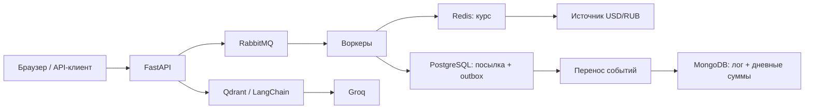

# Delivery Service

Асинхронная регистрация международных посылок, расчёт стоимости, RAG-поддержка и отчётность.
Python 3.12 · FastAPI · Poetry · PostgreSQL · RabbitMQ · Redis · MongoDB · Qdrant.

## Быстрый запуск

Нужны Docker Engine / Docker Desktop с Linux-контейнерами и Compose v2.
Для локальных инструментов нужны Python 3.12, Poetry 2.5.1 и GNU Make.

```shell
poetry env use 3.12
poetry install --with dev
make env
make hooks
docker compose up --build
```

`make env` создаёт `.env` с новым случайным секретом, не перезаписывая существующий файл.
Альтернатива: скопировать `.env.example` в `.env` и самостоятельно заменить `SESSION_SECRET`.
Для ответов помощника вписать `GROQ_API_KEY`; без него отправления работают, чат возвращает понятный `503`.
`GROQ_MODEL` настраивается под доступные модели вашего Groq-аккаунта.

- Интерфейс: [localhost:8000](http://localhost:8000/).
- Swagger: [localhost:8000/docs](http://localhost:8000/docs).
- Состояние: `/health/live`, `/health/ready`; метрики Prometheus: `/metrics`.

Первый запуск загружает модель эмбеддингов; `knowledge-init` индексирует правила.
До окончания индексации чат может отвечать `503`. Статус: `docker compose logs knowledge-init`.
Сервисы хранилищ доступны только во внутренней Docker-сети. Данные сохраняются в volumes.
`docker compose down` останавливает сервисы без удаления данных.
Учебные пароли баз заданы в Compose; для промышленного развёртывания нужны отдельные секреты и TLS.

На Windows после установки Make/Python перезапустите PyCharm для обновления PATH.
Без Make используйте команды из соответствующих целей Makefile напрямую.

## API и сессии

Аккаунтов нет. `GET /api/v1/session` устанавливает подписанную HttpOnly cookie на 30 дней
и возвращает `csrf_token`. Cookie нужно сохранять, CSRF-токен передавать в `X-CSRF-Token`
при POST-запросах. При потере cookie восстановление списка не предусмотрено.
Чужие и несуществующие посылки возвращают одинаковый `404`.

Регистрация: `POST /api/v1/parcels`, заголовок `Idempotency-Key` (1–128 символов):

```json
{"name":"Ноутбук","weight_kg":"2.000","type_id":2,"declared_value_usd":"100.00"}
```

Ответ `202` означает подтверждённый приём RabbitMQ, а не завершённый расчёт:

```json
{"id":"uuid","status":"queued","status_url":"/api/v1/registrations/uuid"}
```

Один ключ в одной сессии на протяжении 24 часов соответствует одной регистрации.
После тайм-аута или `503` повторяйте **то же тело с тем же ключом**.
Изменение тела при повторном ключе даёт `409`. После истечения 24 часов ключ можно использовать заново.

| Маршрут | Назначение |
| --- | --- |
| `GET /api/v1/parcel-types` | Типы: 1 — одежда, 2 — электроника, 3 — разное |
| `GET /api/v1/registrations/{id}` | `publishing`, `queued`, `pending`, `calculated`, `failed` |
| `GET /api/v1/parcels` | Сохранённые воркером посылки текущей сессии |
| `GET /api/v1/parcels/{id}` | Карточка своей посылки |
| `POST /api/v1/parcels/{id}/assignment-token` | Получить/заменить секрет назначения перевозчика |
| `PUT /api/v1/parcels/{id}/carrier` | Назначить компанию: `{"company_id":123}` |
| `POST /api/v1/support/questions` | `{"question":"Можно ли отправить ноутбук?"}` |

Пагинация: `limit=20` (максимум 100) и `cursor` из `next_cursor`. Фильтры: `type_id=2`,
`calculated=true/false`. Курсор подписан и привязан к сессии и фильтрам.
Необработанная очередь ещё не входит в список; её состояние доступно по `status_url` 24 часа,
после сохранения воркером — из PostgreSQL без этого ограничения.

Деньги возвращаются десятичными строками. До расчёта `delivery_cost_rub=null`,
`delivery_cost_display="Не рассчитано"`. Ошибки имеют формат `application/problem+json`
с `code`, `detail`, `request_id`; ошибки валидации — также `errors`.

Перевозчик передаёт `X-Assignment-Token`. Ключ разрешает только назначение, не чтение посылки.
Первый атомарный UPDATE в PostgreSQL закрепляет компанию. Повтор той же компании идемпотентен,
другая получает `409`; новый ключ отзывает прежний. Указанный company_id — идентификатор,
а не подтверждение личности компании. Порядок определяется БД, не часами клиента.

## Надёжность расчёта



API не пишет посылку в БД. Воркеры сначала сохраняют `pending`, затем рассчитывают:

```text
(вес_кг × 0.5 + стоимость_USD × 0.01) × курс_USD_RUB
```

Курс: `https://www.cbr-xml-daily.ru/daily_json.js`, `USD.Value / USD.Nominal`.
Кэш Redis — час, конкурентное обновление защищено короткой блокировкой.
При ошибке источника просроченный кэш не используется. Последняя опубликованная котировка,
полученная успешным запросом в выходной, допустима. Округление — один раз до копеек, ROUND_HALF_UP.

RabbitMQ: persistent messages, quorum queues, mandatory routing, publisher confirms, manual ACK.
При исчерпании брокерного лимита повторных доставок (например, из-за падений воркера)
RabbitMQ передаёт сообщение из `parcels.register` в `parcels.failed` с подтверждением.
Если очередь ранее создавалась вручную с другими аргументами, перед обновлением нужен
перенос оставшихся сообщений и пересоздание пустой очереди с новой конфигурацией.
Повторы через 10 секунд, 1 минуту, 5 минут, 30 минут и 2 часа; затем DLQ и `failed`.
Повтор публикации подтверждается до ACK исходного сообщения. Повторная доставка не начисляет
цену дважды: запись блокируется в PostgreSQL, рассчитанная посылка повторно не меняется.
Регистрация и повторы требуют Redis; сбой Redis не подменяется выдуманным курсом.

Результат и outbox фиксируются одной PostgreSQL-транзакцией. Отдельный процесс переносит события
в MongoDB и только затем помечает их доставленными. В MongoDB лог и увеличение агрегата находятся
в одной транзакции; уникальный event_id устраняет двойной учёт. Compose поднимает Mongo replica set.

## Дневная отчётность и эксплуатация

День — по времени **расчёта** в `Europe/Moscow`. В логе: входные данные, стоимость в копейках,
курс и его дата, время и версия формулы. Суммы разделены на 64 корзины на каждый тип/день;
итог читает максимум 192 агрегата вместо миллиона документов. Отчёт доступен через CLI,
а не публичный HTTP. Он показывает отставание переноса через `pending_outbox` и `provisional`.

```shell
make report DATE=2026-11-17
make verify-report DATE=2026-11-17
make retry ID=идентификатор-посылки
make outbox-once
docker compose exec worker delivery dlq
docker compose up -d --scale worker=4
```

`verify-report` сверяет агрегаты с исходным логом; выполнять при отсутствии активного переноса,
чтобы два чтения не увидели разные моменты времени. Не удаляйте outbox до резервного копирования.
При сбое MongoDB расчёты продолжаются, outbox накапливается. После восстановления перенос возобновляется.
Для ручного повтора сохранённой посылки используйте `retry-parcel`; некорректные сообщения в DLQ
требуют исправления источника, автоматический бесконечный повтор не выполняется.

Логи JSON не содержат cookie, токены, тела запросов и ключ Groq. `X-Request-ID` связывает ответ и лог.
Метрики HTTP экспортируются на `/metrics`; состояние очередей — в RabbitMQ, отставание — в отчёте.
Compose — локальный воспроизводимый стенд, не отказоустойчивый production-кластер.

## RAG

`knowledge/rules.md` содержит явно фиктивные правила. FastEmbed multilingual-MiniLM-L12 векторизует
документы и вопросы локально; LangChain использует Qdrant и ChatGroq. Блоки ограничены окном
токенизатора (максимум 400 токенов), перекрытие до 50, поиск top-4. Повторная индексация
идемпотентна, Qdrant alias переключается атомарно. Версия коллекции зависит от текста, имени
и закреплённой ревизии модели. `make index-knowledge` обновляет базу.

Эмбеддинги вопросов кэшируются на час, чат ограничен 10 вопросами в минуту на сессию.
Groq выбирает идентификаторы релевантных фрагментов в JSON. Приложение проверяет их по
результатам поиска и формирует ответ из полного текста выбранных фрагментов со ссылками.
Пустой выбор, неизвестный источник или неверный формат дают ответ о недостатке информации.
Выбор релевантного фрагмента зависит от модели. Текст правил берётся из индекса Qdrant.
Для офлайн-развёртывания нужно заранее сохранить модель в volume; версия Python-библиотеки
фиксируется lock-файлом, файлы модели загружаются по закреплённому commit SHA из её репозитория.

## Проверки и CI

```shell
make quality
make test-unit
make check
make fix
make pre-commit
make test-unit TEST_ARGS="-k carrier -v"
```

`make check` включает Ruff, форматирование, строгий mypy, Bandit, unit/integration/browser pytest
и Radon, затем запускает pre-commit для отслеживаемых Git файлов. Нужен запущенный Docker.
Radon выводит метрики, не блокирует по порогу сложности.
Интеграционные тесты работают в отдельном Compose-проекте с уникальным именем, удаляют только свои
volumes и не используют ключ Groq. Реальный PostgreSQL проверяет конкурентность; MongoDB —
дедупликацию и суммы; RabbitMQ — повторную доставку; Playwright — путь пользователя.
Порог покрытия полного набора — 85%. CI запускается на push и pull request и проверяет Docker build.

Нагрузочный тест запускается **только на отдельном стенде**, он создаёт реальные посылки:

```shell
make load TEST_ARGS="--count 1000000 --concurrency 50"
```

Он измеряет скорость приёма, ошибки и p95 HTTP. Для производительности полного конвейера дополнительно
дождитесь опустошения очереди и outbox, проверьте число расчётов и `verify-report`.
Миллион в сутки — около 11.6 посылок/с в среднем; фактический предел зависит от оборудования и
подтверждается нагрузочным прогоном, а не архитектурой самой по себе.
